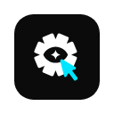

<p align="center">
  
</p>

<h1 align="center">Redlines</h1>

<p align="center">
  Pin notes to any element on any live website, then hand them to your developer or your AI coding agent.<br>
  Local-first. No account. Nothing uploaded.
</p>

<p align="center">
  <a href="docs/GUIDE.md">Guide</a> ·
  <a href="../../releases">Download</a> ·
  <a href="../../issues">Report a problem</a>
</p>

---

## What it does

- **Inspect any element** on any page (`Alt+Shift+M`), click it, and write a note. Redlines saves the element's selector, a fingerprint, its position and a cropped screenshot.
- **Categories:** Layout Bug, Suggestion, Text, General Note, or any word you type.
- **Sidebar and table view:** filter, edit, resolve, undo a delete, jump back to the element, re-pin it when the page changes.
- **Export** to Excel (screenshots embedded), HTML report, CSV, PDF, ZIP, or copy as Markdown, JSON, XML, Notion, Linear or Jira.
- **AI agents (MCP):** Claude Code, Codex, Cursor, Windsurf, Gemini CLI, Cline, Zed, Claude Desktop and other MCP tools can read your notes, open the page, highlight the element and resolve notes. Several agents can be connected at once, and you can send a note to a specific one.
- **Enhance (optional):** rewrite a rough note into a precise coding prompt with your own Anthropic, OpenAI or OpenRouter key.

## How it compares

|  | Redlines | Agentation | Vibe Annotations | Pointa |
|---|---|---|---|---|
| Works on any live site, not just localhost | ✓ | — | — | — |
| No install inside your app or framework | ✓ | — (React) | ✓ | ✓ |
| Several AI agents at once | ✓ | — | — | — |
| Exports for non-AI workflows (Excel, Jira, PDF) | ✓ | — | partial | — |
| Fully local, no account | ✓ | ✓ | ✓ | ✓ |

## Install

Chrome Web Store and Edge Add-ons listings are coming soon. Until then:

1. Click the green **Code** button on this page → **Download ZIP**, and unzip it.
2. Open `chrome://extensions` (or `edge://extensions`) and switch on **Developer mode**.
3. Click **Load unpacked** and pick the unzipped folder (the one with `manifest.json`).
4. Open any page and press `Alt+Shift+M`. For local `file://` pages, enable "Allow access to file URLs" on the extension's details page.

## Connect an AI agent

Needs Node.js 18+ and an MCP-capable AI tool on the same computer.

1. Redlines **Settings → Connect to AI agents → On**. You get a private pairing code.
2. Pick your AI tool and copy the ready-made command or JSON into it.
3. The status turns **Connected**. Ask your agent: *"fix all open Redlines bugs on localhost:3000"*.

The bridge listens on `127.0.0.1` only, accepts only the extension, needs your pairing code, shows only the sites you share, and is read-only unless you allow changes. Details: [docs/GUIDE.md](docs/GUIDE.md#connect-to-ai-agents-mcp).

## Keyboard shortcuts

| Keys | What it does |
|---|---|
| `Alt+Shift+M` | Inspect mode on or off |
| `Alt+Shift+D` | Open or close the notes sidebar |
| `Alt+Shift+H` | Show or hide the dock |
| `Esc` | Close the innermost layer |

## Privacy

Notes and screenshots stay in your browser's extension storage. Marking, saving and viewing work offline. Nothing leaves your machine except when you explicitly use Enhance (your AI provider, your key), Send to Google Drive (your Drive), or the local agent bridge. No analytics, no telemetry, no server. See [PRIVACY_AND_PERMISSIONS.md](docs/PRIVACY_AND_PERMISSIONS.md).

## For developers

Plain JavaScript, HTML and CSS. No build step and no dependencies.

```
manifest.json, *.js, *.html, *.css   the extension
fonts/, icons/, brand/               bundled fonts, icons and the two logo files the UI loads
mcp/       the local MCP bridge for AI agents (Node, no dependencies)
docs/      user guide and privacy
archive/   not shipped: tests, design system, product and UX notes, logo masters
```

```bash
node archive/tests/selector-fingerprint.test.js
node archive/tests/content-helpers.test.js
node archive/tests/mcp-structure.test.js
node archive/tests/browser-smoke.js     # real Chrome; see archive/CLAUDE.md for every suite
```

## License

[MIT](LICENSE) © 2026 Varul Verma. The Redlines name and logo are not covered by the license.
